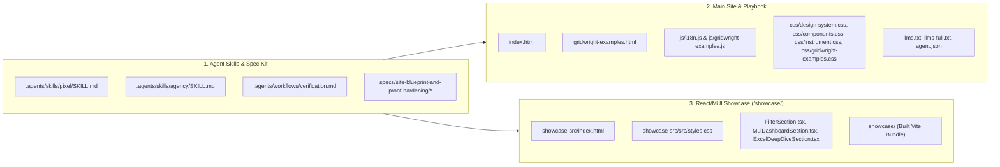

# Technical Plan: APSW Site Blueprint Visual Hardening & Open-Source Trilogy Proof

## 1. Architecture & Files Modified

## 2. Detailed Component Changes

1. **CSS Layer (`css/design-system.css`, `css/components.css`, `css/instrument.css`, `css/gridwright-examples.css`):**
   - Unify `.btn-emerald` in light mode to use `--brand-teal-dark` (`#044259`) with `--brand-teal-mid` (`#075a7a`) hover, matching dark mode's cyan primary action (`#38bdf8`), so there is strictly **one accent colour** for actions across both themes.
   - Make `.section-tag` and `.section-tag.emerald` use `--text-muted` text and `--instrument-bracket` (`#0a82b0` light / `#38bdf8` dark) brackets consistently.
   - Style `.hero-status-badge` and `.gw-hero-badge` as squared (`border-radius: 4px`) monospace instrument readouts (`background: var(--bg-surface-1)`, `border: 1px solid var(--border-medium)`, `color: var(--text-secondary)`) with only the leading `●` dot in semantic emerald (`--accent-emerald`).
   - Hide/remove `.gw-card-glow` and replace `.engagement-card.featured` permanent green border with `--border-brand` and active corner registration marks (`::before` / `::after`).
   - Add semantic classes for `#architect`, `#contact`, `#agentic-dev` workflow card, and `gridwright-examples.html` to eliminate inline `style="..."` hex codes.

2. **Main Landing Page & i18n (`index.html`, `js/i18n.js`, `llms.txt`, `llms-full.txt`, `agent.json`):**
   - In `#assurance`: add direct deep-links into `/showcase/#virtual`, `/showcase/#excel`, `/showcase/#accessibility`, and `/showcase/#mui-dashboard` in `assurance.note_html`, and clarify the 24h written fixed-price proposal under `oneNDA` in `assurance.offer_desc`.
   - In `#speckit` and `#services`: replace `.step-icon-wrap` and `.service-icon-wrap` SVG boxes with clean monospace index badges (`[ 01 ]` .. `[ 06 ]`).
   - In `#agentic-dev`: replace the fake purple `AGENTIC_SWARM_ORCHESTRATION.log` with a real `workflow.ai.yml` + `.indaba/traces` execution readout (`workflow.ai.yml · @indaba/engine`) in both `index.html` and `js/i18n.js` (EN & PL).
   - In `#gridwright-showcase`: highlight all three npm packages (`apsw-gridwright`, `apsw-gridwright-mui`, and `apsw-mui-excel-filter` with its legacy ERP extraction & 47-test 100%-coverage proof) and link directly to `showcase/#excel` and npm.
   - Bump all CSS/JS `?v=` query parameters to `?v=20261016`.

3. **Showcase App (`showcase-src/` -> `showcase/`):**
   - In `showcase-src/index.html`: set `#sc-banner` default text to English (matching the English React showcase and GitHub/npm/Reddit audience) and add a tiny inline script that switches `#sc-banner` to Polish if `localStorage.getItem('apsw_lang') === 'pl'` (or `navigator.language` starts with `'pl'` when `apsw_lang` is unset).
   - In `FilterSection.tsx`, `MuiDashboardSection.tsx`, and `ExcelDeepDiveSection.tsx`: add Gridwright's `responsive()` add-on and `hideBelow` breakpoints on secondary columns so the grids adapt cleanly on phones/tablets without horizontal page overflow.
   - In `showcase-src/src/styles.css`: remove the blanket `.sc-grid .gw-root { min-width: 640px }` rule (or scope it only to non-responsive grids) and ensure `.sc-dashboard__bar` takes `100%` width below `768px`.
   - Run `npm run build` in `showcase-src` to update `showcase/`.
